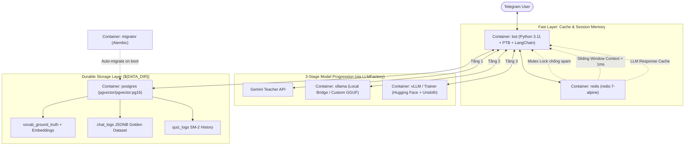

# Project Plan: Knowledge Distillation Telegram AI Bot (Docker-First & 3-Stage AI)
*Architecture: Dockerized Python Bot + LangChain + Redis + PostgreSQL (pgvector)*
*Model Progression: Gemini (Teacher) ➔ Open Source via Ollama (Local Bridge) ➔ Hugging Face Models (Fine-tuned Student)*

---

## 1. Chiến Lược Docker-First (Chạy Đồng Nhất Trên Nhiều Máy Cho Team)

Để dự án hoạt động ổn định trên **mọi máy tính** của team (Windows, macOS, Linux, có hoặc không có GPU) ngay từ ngày đầu tiên:

1. **Container hóa toàn diện ngay từ Giai đoạn 1:** Toàn bộ Bot Python, Migrator (Alembic), PostgreSQL (`pgvector`), Redis và Ollama đều chạy trong các Docker containers chuẩn hóa qua `docker-compose.yml`.
2. **Đường dẫn Volume Di động (`${DATA_DIR}`):** Không hardcode đường dẫn ổ `E:\` vào file Compose. Thay vào đó dùng `${DATA_DIR:-./data}` trong `.env`. Trên máy cá nhân của bạn có thể set `DATA_DIR=E:/AI-Telegram/data`, còn máy đồng đội dùng mặc định `./data` hoặc ổ đĩa riêng của họ.
3. **Tách Profile Phần Cứng (`docker-compose.gpu.yml`):** Máy có NVIDIA GPU chạy thêm file override để cấp phát VRAM cho Ollama/Training; máy không có GPU (như MacBook, laptop văn phòng) vẫn chạy bình thường ở chế độ CPU hoặc Gemini API mà không bị lỗi driver.
4. **Auto-Migration & Healthchecks:** Service `migrator` tự động chạy `alembic upgrade head` ngay khi `postgres` đạt trạng thái `healthy`. Bất kỳ ai clone repo về chỉ cần 1 lệnh `docker compose up -d` là hệ thống tự lên hoàn chỉnh.

---

## 2. Lộ Trình Tiến Hóa Mô Hình 3 Tầng (3-Stage AI Pipeline)

1. **Tầng 1 — Gemini API (`AI_BACKEND=gemini`):** Dùng `ChatGoogleGenerativeAI` làm **Teacher** tạo dữ liệu vàng, chuẩn hóa từ vựng JSON qua Pydantic.
2. **Tầng 2 — Open Source qua Ollama (`AI_BACKEND=ollama`):** Dùng container **Ollama** + `ChatOllama` chạy `qwen2.5:7b` / `llama3.1:8b` làm **cầu nối local**, đóng vai trò Fallback và Baseline Benchmark.
3. **Tầng 3 — Các Model của Hugging Face (`AI_BACKEND=huggingface`):** Đóng gói Training Container (`Dockerfile.train` với CUDA + Unsloth + Hugging Face) để fine-tune QLoRA 4-bit trên Golden Dataset. Model mới có thể chạy qua `vLLM` (Safetensors) hoặc xuất GGUF nạp vào **Ollama** (`Modelfile`) cho toàn team dùng chung.

---

## 3. Kiến Trúc Hệ Thống Dockerized

---

## 4. Tóm Tắt 17 Tasks Theo 3 Giai Đoạn (Chi tiết tại `tasks/todo.md`)

- **Giai đoạn 1 (Tasks 1–7): Docker-First Foundation & Thu thập bằng Gemini**
  - Setup `Dockerfile` multi-stage, `docker-compose.yml` (với Profiles & Healthchecks), `docker-compose.gpu.yml`, biến `${DATA_DIR}`.
  - SQLAlchemy Async Models + Alembic Auto-Migration container (`migrator`).
  - `RedisService` (Sliding window, Mutex Lock chống spam, Cache) + `LLMFactory` + Bot Handlers + JobQueue Quiz.
- **Giai đoạn 2 (Tasks 8–12): Tích lũy Golden Dataset & Cầu nối Ollama**
  - Thuật toán SM-2, Sanitizer khử AI Boilerplate, tinh chỉnh System Prompt.
  - Tích hợp container **Ollama** (Local Fallback & Baseline Benchmark) và CLI Dataset Monitor.
- **Giai đoạn 3 (Tasks 13–17): Fine-Tune Hugging Face & Tự Chủ Đa Máy**
  - Export `dataset.jsonl` -> Training Container (`Dockerfile.train` + Unsloth + Hugging Face QLoRA).
  - Benchmark & Export (HF Safetensors cho vLLM / GGUF nạp vào Ollama `Modelfile`).
  - PGVector Hybrid RAG, hoàn thiện Production Compose & tài liệu Team Onboarding (`README.md`), ngắt hoàn toàn Gemini API.
