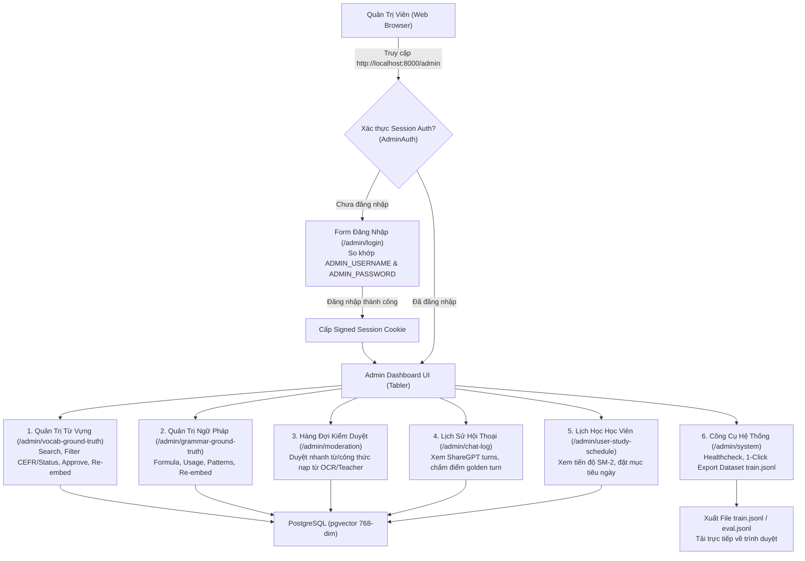

# Kiến Trúc Kỹ Thuật: Web Admin Dashboard (FastAPI + SQLAdmin)
**Mục tiêu:** Cung cấp giao diện quản trị Web trực quan, gọn nhẹ, bảo mật cao để quản lý toàn bộ kho tri thức (`vocab_ground_truth`, `grammar_ground_truth`), hàng đợi kiểm duyệt OCR & Teacher (`status='pending'`), lịch sử chat (`chat_logs`), lịch học của người dùng (`user_study_schedules`) và tải tập dữ liệu chưng cất QLoRA (`train.jsonl` / `eval.jsonl`).

--------------------------------------------------------------------------------

## 1. Triết Lý Thiết Kế & Lựa Chọn Công Nghệ

| Thành phần | Lựa chọn công nghệ | Lý do kỹ thuật |
| :--- | :--- | :--- |
| **Framework Web** | **FastAPI + Uvicorn** | Bất đồng bộ (Async Native), tích hợp liền mạch với `asyncpg` và SQLAlchemy 2.0 Async của dự án, tốc độ cực cao. |
| **Admin Engine** | **SQLAdmin (`sqladmin>=0.20.0`)** | Đọc trực tiếp SQLAlchemy Models hiện có, tự động sinh giao diện CRUD chuyên nghiệp (Tabler/Bootstrap), hỗ trợ tìm kiếm, lọc, phân trang, và custom actions. 0 tốn công dựng frontend riêng. |
| **Bảo Mật (Auth)** | **Session-based `AdminAuth`** | Xác thực đăng nhập qua cookie session có mã hóa ký số (`ADMIN_SECRET_KEY`), bảo vệ toàn bộ route `/admin`. Cấu hình tài khoản qua `.env`. |
| **Triển Khai Container** | **Service `admin` trong Docker Compose** | Tách biệt với container `bot` để đảm bảo bot chạy polling không bị ảnh hưởng khi admin duyệt web; cùng mạng `ai_net` và cùng mount mã nguồn `./src`. Mở cổng `8000`. |

--------------------------------------------------------------------------------

## 2. Kiến Trúc Luồng Quản Trị & Tương Tác Dữ Liệu

--------------------------------------------------------------------------------

## 3. Chi Tiết Các ModelView Trong SQLAdmin

### 3.1. `VocabGroundTruthAdmin` (`ModelView`, model=`VocabGroundTruth`)
* **Tên hiển thị:** 📚 Từ Vựng Ground Truth
* **Icon:** `fa-solid fa-book-bookmark`
* **Cột hiển thị (list):** `word`, `cefr_level`, `status`, `source`, `usage_count`, `report_count`, `next_review_at`, `created_at`.
* **Bộ lọc (filters):** `status` (`verified`, `pending`, `quarantined`, `rejected`), `cefr_level` (A1..C2), `source` (`global_seed`, `teacher_gemini`, `document_ocr`).
* **Tìm kiếm (search):** `word`, `definition_vi`, `definition_en`.
* **Custom Batch Actions:**
  * `✅ Phê duyệt (Approve)`: Đổi status sang `'verified'`.
  * `🚩 Cách ly (Quarantine)`: Đổi status sang `'quarantined'`.
  * `❌ Từ chối (Reject)`: Đổi status sang `'rejected'`.
  * `⚡ Nhúng lại Vector (Re-embed)`: Gọi `EmbeddingService` nhúng lại vector 768 chiều `nomic-embed-text`.

### 3.2. `GrammarGroundTruthAdmin` (`ModelView`, model=`GrammarGroundTruth`)
* **Tên hiển thị:** 📐 Công Thức Ngữ Pháp
* **Icon:** `fa-solid fa-graduation-cap`
* **Cột hiển thị (list):** `pattern_key`, `title`, `cefr_level`, `status`, `source`, `usage_count`, `report_count`, `created_at`.
* **Bộ lọc (filters):** `status`, `cefr_level`, `source`.
* **Tìm kiếm (search):** `pattern_key`, `title`, `formula`, `usage_vi`.
* **Chi tiết (detail):** Hiển thị công thức, cách dùng tiếng Việt, danh sách ví dụ JSON đẹp mắt, trạng thái vector 768 chiều.

### 3.3. `ChatLogAdmin` (`ModelView`, model=`ChatLog`)
* **Tên hiển thị:** 💬 Lịch Sử Trò Chuyện
* **Icon:** `fa-solid fa-comments`
* **Cột hiển thị (list):** `telegram_user_id`, `ai_backend`, `model_name`, `prompt` (cắt ngắn 50 ký tự), `response` (cắt ngắn 50 ký tự), `created_at`.
* **Bộ lọc (filters):** `ai_backend` (`gemini`, `ollama`), `model_name`.
* **Tìm kiếm (search):** `prompt`, `response`.
* **Chi tiết (detail):** Hiển thị đầy đủ lượt hội thoại ShareGPT format (`turns_json`) để kiểm tra chất lượng suy luận.

### 3.4. `UserStudyScheduleAdmin` (`ModelView`, model=`UserStudySchedule`)
* **Tên hiển thị:** ⏰ Lịch Học Của Học Viên
* **Icon:** `fa-solid fa-calendar-check`
* **Cột hiển thị (list):** `telegram_user_id`, `daily_target_words`, `preferred_study_time`, `is_active`, `updated_at`.
* **Cho phép sửa (can_edit):** Có thể bật/tắt `is_active` hoặc điều chỉnh `daily_target_words`.

### 3.5. Trang Tổng Quan & Công Cụ Hệ Thống (`/admin/dashboard` & `/admin/actions`)
* Thẻ số liệu thống kê: Tổng từ vựng, Số lượng chờ duyệt (Pending), Tổng công thức, Tổng lượt chat.
* Nút bấm **"Tải Dataset Fine-Tuning"**: Tự động lọc các bản ghi `verified` và xuất file `train.jsonl` (90%) và `eval.jsonl` (10%) tải về máy.
* Trạng thái kết nối: PostgreSQL (pgvector extension), Redis, Host Ollama.

