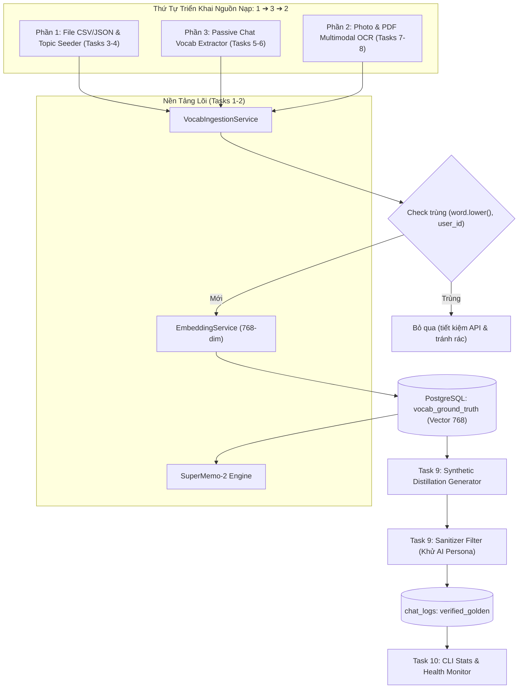

# Sub-Plan: Ground Truth Ingestion (1 ➔ 3 ➔ 2) & Distillation Data Pipeline
*Tài liệu quy hoạch chuyên sâu cho phân hệ nạp dữ liệu Ground Truth & chuẩn hóa dữ liệu huấn luyện (nằm trong thư mục con độc lập, bảo toàn nguyên vẹn các bản plan tổng thể trước đó).*

---

## 1. Overview & Execution Order
Mục tiêu của kế hoạch này là xây dựng hoàn chỉnh hệ thống **nạp tri thức chuẩn (`vocab_ground_truth`)**, **tạo vector `768` chiều cho `pgvector`**, và **biến Ground Truth thành dữ liệu huấn luyện (`chat_logs` chuẩn ShareGPT)** theo đúng thứ tự ưu tiên đã chốt:

1. **Nền tảng Lõi (Foundation):** `VocabIngestionService` (chống trùng + tạo Vector 768 chiều) & thuật toán **SM-2**.
2. **Phần 1 — Seeder Đẩy Vào:** Nạp hàng loạt từ file `.csv`/`.json` và sinh batch từ vựng theo danh sách chủ đề.
3. **Phần 3 — Học Từ Cuộc Chat Của User:** Tự động trích xuất từ vựng mới/khó ngay trong luồng chat Telegram qua background hook không chặn tin nhắn chính.
4. **Phần 2 — Multimodal OCR Đọc Tài Liệu:** Dùng **Gemini 3.8 Flash Vision** + `pypdf` đọc ảnh chụp trang sách, screenshot, và file PDF gửi qua Telegram.
5. **Chuyển Hóa Thành Dữ Liệu Train:** Lọc sạch bằng **Sanitizer** và sinh cặp hỏi–đáp **Synthetic Distillation** từ `vocab_ground_truth` đổ vào `chat_logs` (`verified_golden`).

---

## 2. Architecture & Data Flow

---

## 3. Architecture Decisions & Constraints

1. **Unified Ingestion Service (DRY & SOLID):** Cả Phần 1, Phần 3 và Phần 2 đều chỉ làm nhiệm vụ *trích xuất ra `List[VocabSchema]`*, sau đó đẩy qua cùng một dịch vụ `VocabIngestionService` để chuẩn hóa chữ thường, kiểm tra trùng lặp trong DB, gọi `EmbeddingService` và insert vào PostgreSQL. Không viết lặp logic lưu DB ở từng nguồn.
2. **Khớp Dimension `Vector(768)`:** Bảng `vocab_ground_truth` trong [models.py](file:///e:/AI-Telegram/src/db/models.py) dùng `Vector(768)`. Vì vậy `GoogleGenerativeAIEmbeddings` bắt buộc truyền `output_dimensionality=768` để khớp tuyệt đối với schema PostgreSQL hiện tại.
3. **Multimodal Vision thay cho Tesseract (Phần 2):** Tận dụng `gemini-3.8-flash` hỗ trợ trực tiếp ảnh và text multimodal thông qua LangChain `HumanMessage`, loại bỏ việc phải cài đặt Tesseract/Poppler cồng kềnh vào Docker image. Với file PDF, dùng thư viện nhẹ `pypdf` tách từng cụm 3 trang để tránh vượt giới hạn token hoặc timeout.
4. **Non-Blocking Background Hook (Phần 3):** Tác vụ phân tích tin nhắn chat để nhặt từ vựng chạy qua `asyncio.create_task` sau khi đã gửi câu trả lời cho user, kèm `try/except` cô lập hoàn toàn để lỗi trích xuất không bao giờ làm sập cuộc trò chuyện chính.

---

## 4. Task Index (Chi tiết tại `todo.md` trong cùng thư mục)

- **Nền tảng Lõi:** Task 1 (`VocabIngestionService` & `EmbeddingService`), Task 2 (SM-2 Engine).
- **Phần 1 (Seeder):** Task 3 (`CSV`/`JSON` File Seeder CLI), Task 4 (Topic Batch Generator).
- **Phần 3 (Chat Extraction):** Task 5 (`VocabExtractorService`), Task 6 (Non-blocking Telegram Background Hook).
- **Phần 2 (Multimodal OCR):** Task 7 (`VisionExtractorService` + `pypdf` chunking), Task 8 (Telegram Photo/PDF Handler).
- **Chuyển hóa dữ liệu học:** Task 9 (`SanitizerService` + Synthetic Q&A Distillation Generator), Task 10 (CLI Stats & Health Monitor).

---

## 5. Risks and Mitigations

| Rủi ro / Edge-case | Mức độ | Biện pháp xử lý |
| :--- | :--- | :--- |
| **Gửi file PDF lớn hoặc ảnh mờ không có chữ** | Cao | Giới hạn size file Telegram 20MB; tách chunk 3 trang/lần; cho phép `VocabBatchSchema` trả về `items: []` và báo nhẹ nhàng cho user. |
| **Tốn quota Gemini cho các từ đã tồn tại** | Trung bình | Check trùng `word.strip().lower()` trong DB **trước** khi gọi Gemini enrich hoặc tạo Embedding. |
| **Phần 3 bắt nhầm từ quá cơ bản (`"hello"`, `"good"`)** | Trung bình | Prompt extractor chỉ định rõ chỉ lấy từ vựng học thuật/giao tiếp từ B1+ trở lên hoặc từ user trực tiếp hỏi nghĩa. |
| **Chậm phản hồi tin nhắn chat chính vì Phần 3** | Cao | Tách hoàn toàn sang background task chạy sau khi `reply_text` đã gửi xong. |
| **Synthetic Q&A sinh câu có văn phong AI máy móc** | Cao | Bắt buộc đi qua `SanitizerService` lọc AI boilerplate song ngữ trước khi gắn cờ `verified_golden`. |

