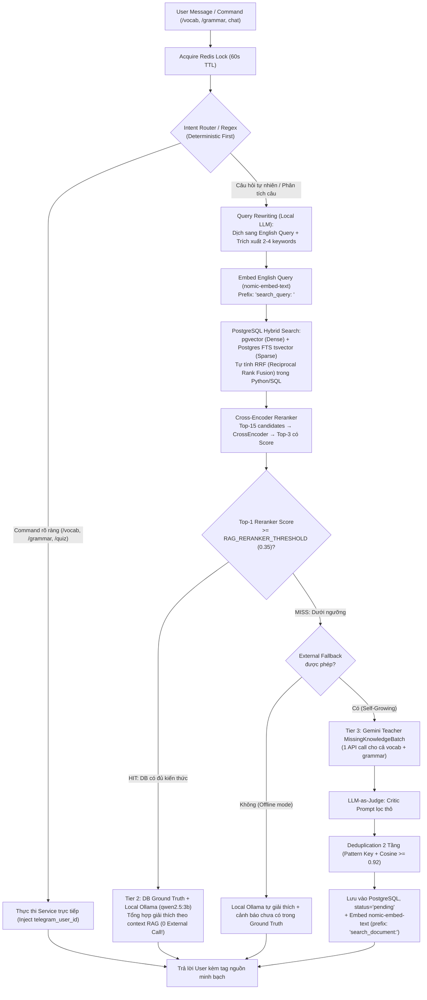
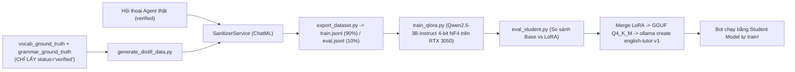

# Kiến Trúc Tổng Thể: AI Agent (DB-First Vector Router) + Local Ollama + Hybrid RAG + QLoRA (Phase 3)
**Phiên bản:** v2.1 — Cập nhật Postgres FTS (thay BM25 in-memory), Ngưỡng Reranker HIT/MISS, Context-Injected Security cho Tool, Tiếng Việt Query Rewriter, và Bộ lọc Fine-tuning nghiêm ngặt.
**Triết lý cốt lõi ("DB-First, Local-Second, External-Teacher-Last-Resort"):** Bot **KHÔNG** đẩy thẳng câu hỏi ra AI ngoài. Mọi truy vấn từ vựng, ngữ pháp, phân tích câu đều đi qua **Postgres Hybrid Search (pgvector + PostgreSQL Full-Text Search)** trước. Chỉ khi DB thiếu kiến thức (Reranker dưới ngưỡng), Agent mới gọi Teacher API ngoài để tra cứu **và tự động nạp ngược lại vào PostgreSQL** sau khi qua bộ lọc kiểm duyệt.

--------------------------------------------------------------------------------

### 1. Phân Tích Phần Cứng & Tài Nguyên Thực Tế Trên Máy
* **GPU:** NVIDIA GeForce RTX 3050 Laptop GPU — **4096 MiB VRAM** (~3.5 GB trống).
* **RAM hệ thống:** **~24 GB**.
* **Ollama Host:** ollama 0.20.2 đang chạy sẵn trên Windows host, đã có:
    * `nomic-embed-text:latest` (274 MB, xuất **768 chiều** khớp cột `Vector(768)` trong PostgreSQL).
    * `qwen2.5:3b`, `qwen3:8b`, `llama3.1:8b`.

| Thành phần | Lựa chọn thiết kế | Lý do kỹ thuật |
| :--- | :--- | :--- |
| **Runtime Ollama** | **Host Ollama** qua `http://host.docker.internal:11434` | Dùng thẳng GPU Windows host, không tốn RAM/disk nhân đôi weights. |
| **Local Student LLM** | `qwen2.5:3b` (~2.0 GB VRAM) mặc định | Nằm gọn **100% trong 4GB VRAM**, suy luận nhanh và phản hồi tức thì. |
| **Local Embedding** | **nomic-embed-text (Ollama, 768-dim)** | 100% offline, 0 chi phí API khi chạy Vector Search. |
| **Local Reranker** | `bge-reranker-base` hoặc `ms-marco-MiniLM-L-6-v2` | Chạy nhanh trên CPU/GPU, phân tách điểm liên quan vượt trội so với cosine. |
| **QLoRA Fine-Tune** | `Qwen/Qwen2.5-3B-Instruct` (4-bit NF4, max_seq_length=1024) | Vừa khít RTX 3050; export GGUF Q4_K_M nạp ngược vào Ollama thành model tự train. |

--------------------------------------------------------------------------------

### 2. Cơ Chế AI Agent Phân Tầng (3-Tier DB-First Router)



#### Quy tắc gắn nhãn minh bạch trong câu trả lời:
* **`[📦 DB Ground Truth]`**: Top-1 Reranker score rất cao, trả về ngay từ PostgreSQL (< 50ms), **0 lần gọi LLM**.
* **`[🧠 Local Agent • Ollama + RAG]`**: Context DB đủ (Reranker >= ngưỡng), Model Local (`qwen2.5:3b`) tổng hợp giải thích, **0 lần gọi Gemini**, tăng `usage_count` cho bản ghi DB.
* **`[🌐 Teacher Fallback ➔ Đã nạp DB]`**: Reranker báo MISS (hoặc cả 15 candidate không liên quan), hệ thống mới nhờ Gemini tra cứu → lưu vào PostgreSQL với `status='pending'` chờ admin duyệt.

--------------------------------------------------------------------------------

### 2.5. Pipeline RAG Kỹ Thuật Chi Tiết (Production-Grade 5-Bước)

#### Bước 1 — Nomic Prefix Convention (Bắt buộc)
* Nạp document vào DB: Tiền tố `"search_document: "`
* User tìm kiếm: Tiền tố `"search_query: "`

```python
class NomicEmbeddingsWrapper:
    """Wraps OllamaEmbeddings to auto-add Nomic required prefixes."""
    def __init__(self, base_embeddings):
        self.embeddings = base_embeddings

    def embed_documents(self, texts):
        return self.embeddings.embed_documents([f"search_document: {t}" for t in texts])

    def embed_query(self, text):
        return self.embeddings.embed_query(f"search_query: {text}")
```

#### Bước 2 — Query Rewriting & Bilingual Normalization (Xử lý Tiếng Việt & Câu Phức)
Do `nomic-embed-text` và các reranker phổ biến (`MiniLM`, `bge-reranker-base`) tối ưu mạnh cho tiếng Anh, bước Query Rewriting bắt buộc chuẩn hóa ngôn ngữ:
* **Input của User:** *"Điểm nghẽn cổ chai và cấu trúc đảo ngữ Had I known..."*
* **LLM Prompt nhẹ xuất JSON:**
  1. `keywords`: Danh sách 2–4 từ khóa tiếng Anh: `["bottleneck", "Third Conditional Inversion"]`
  2. `english_query`: Câu truy vấn tiếng Anh chuẩn: `"System bottleneck mitigation and Third Conditional Inversion with Had"`
* Dùng `english_query` để embed vector và rerank.

#### Bước 3 — Postgres Native Hybrid Search (Thay thế BM25 In-Memory)
Loại bỏ hoàn toàn `BM25Retriever` của LangChain (in-memory, dễ lệch dữ liệu khi có bản ghi mới). Sử dụng trực tiếp PostgreSQL:
* **Sparse Search (Full-Text Search):** Dùng `to_tsvector('english', title || ' ' || formula || ' ' || usage_vi)` có đánh chỉ mục GIN + extension `pg_trgm` (trigram) chống gõ sai.
* **Dense Search (pgvector):** Dùng toán tử cosine `<=>` với HNSW index.
* **Hợp nhất bằng RRF (Reciprocal Rank Fusion) trong Python/SQL:**
  $$RRF(d) = \frac{0.5}{60 + rank_{fts}(d)} + \frac{0.5}{60 + rank_{vector}(d)}$$
  Lấy Top `RAG_CANDIDATE_K = 15`.

#### Bước 4 — Cross-Encoder Reranker + Threshold Gate (Bắt Buộc Có Ngưỡng)
* Đưa 15 candidates vào Cross-Encoder Reranker (`cross-encoder/ms-marco-MiniLM-L-6-v2` hoặc `bge-reranker-base`).
* Lấy ra Top-3 có điểm cao nhất.
* **Threshold Gate:** Kiểm tra xem `top1_score >= RAG_RERANKER_THRESHOLD` (mặc định cấu hình `0.35`):
  * Nếu `>= 0.35`: Coi là **HIT**, truyền context vào Local LLM trả lời.
  * Nếu `< 0.35` (kể cả khi lấy đủ 3 kết quả nhưng đều không liên quan): Coi là **MISS**, chuyển sang Tier 3 Fallback.

#### Bước 5 — Đánh Giá Chất Lượng: Hit Rate@3 & False-Hit Rate
Tạo file `datasets/eval_benchmark.json` gồm **65 câu test**:
* **50 câu Positive (DB có câu trả lời):** Đo `Hit Rate@3` (mục tiêu $\ge 80\%$).
* **15 câu Negative (Should-Miss - DB chắc chắn không có):** Đo `False-Hit Rate` (mục tiêu $< 5\%$, đảm bảo bot không tự tin bịa chuyện khi DB thiếu dữ liệu).

--------------------------------------------------------------------------------

### 3. Hệ Thống Lệnh Telegram & Bảo Mật Tool Calling

#### 3.1. Các lệnh Telegram (CommandHandler cố định)
* `/vocab` (alias `/vocal`): Quản lý lịch học SM-2, tra từ vựng DB-First.
* `/grammar` (alias `/gramma`): Tra cứu công thức, phân tích cấu trúc câu DB-First.
* `/quiz`: Kích hoạt ngay 1 câu trắc nghiệm từ đến hạn.
* `/report`: Gắn cờ bản ghi sai → chuyển ngay `status = 'quarantined'`, tăng `report_count`.

#### 3.2. Bảo Mật Tool Calling: Context Injection (Tuyệt đối không để LLM điền `user_id`)
* **Lỗ hổng cũ:** Tool khai báo nhận `user_id` từ LLM → dễ bị Prompt Injection hoặc Model 3B điền nhầm ID người khác.
* **Giải pháp chuẩn:** Bỏ hoàn toàn `user_id` khỏi schema tham số của Tool. `telegram_user_id` được inject trực tiếp từ session Telegram đã xác thực:

```python
# Schema tool cho LLM thấy (KHÔNG CÓ user_id):
def enroll_study_schedule_tool(daily_goal: int, reminder_time: str):
    """Lên lịch học từ vựng mỗi ngày."""
    pass

# Wrapper thực thi phía Backend:
def execute_tool(tool_name, tool_args, telegram_user_id: int):
    if tool_name == "enroll_study_schedule_tool":
        return schedule_service.set_schedule(
            user_id=telegram_user_id, # Inject an toàn từ context
            daily_goal=tool_args["daily_goal"],
            reminder_time=tool_args["reminder_time"]
        )
```

#### 3.3. Intent Routing Cho Model 3B
Không để model 3B tự do phân vân giữa 5 tool cùng lúc. Sử dụng pipeline:
1. Gõ lệnh `/...` → Đi thẳng vào CommandHandler chuyên trách.
2. Chat tự nhiên → Đi qua Regex/Keyword router nhẹ:
   * Nếu chứa từ khóa lịch học/nhắc nhở → gọi Tool Schedule.
   * Nếu là câu hỏi phân tích/tra cứu → đi vào Hybrid RAG Pipeline.
   * Nếu là chat trò chuyện tự do → chuyển Local LLM xử lý.

--------------------------------------------------------------------------------

#### 4. Data Governance & Ngăn Ngừa Data Poisoning

#### 4.1. Cấu Trúc Data Governance Fields
Bổ sung vào cả `vocab_ground_truth` và `grammar_ground_truth`:
* `source`: `'global_seed'`, `'teacher_gemini'`, `'human_expert'`.
* `status`: `'pending'`, `'verified'`, `'quarantined'`, `'rejected'`.
* `usage_count`: Số lần RAG truy xuất.
* `report_count`: Số lần bị bấm `/report`.
* `embedding_model`: `'nomic-embed-text'`.

#### 4.2. Luật Lọc Cho Tập Huấn Luyện Fine-Tuning (Chống Vòng Lặp Độc Hại)
Để tránh hiện tượng model tự học lại kiến thức sai:
* **Tập train (`train.jsonl`): CHỈ CHẤP NHẬN BẢN GHI CÓ `status = 'verified'`** (đã qua con người xác thực từ seed hoặc admin review).
* **Tuyệt đối KHÔNG cho phép bản ghi `pending` tự động vào tập train** dù có `usage_count >= 10`.
* `LLM-as-Judge` chỉ đóng vai trò bộ lọc thô (First-pass gatekeeper) phát hiện format rác, không dùng làm căn cứ tự phong "Ground Truth".

--------------------------------------------------------------------------------

#### 5. Vòng Khép Kín Distillation & QLoRA Fine-Tuning (Stage 3)


