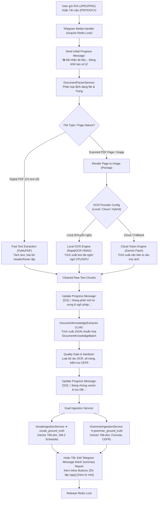

# Kiến Trúc Kỹ Thuật: Module Bóc Tách OCR Tài Liệu & Nhận Diện Đa Phương Thức Thông Minh (Phase 4)
**Phiên bản:** v4.0 — Tích hợp Hybrid OCR Engine (Local Fast OCR + Cloud Vision Teacher), Xử lý Scanned PDF (PyMuPDF + Pixmap), Bóc tách kép Từ Vựng & Cấu Trúc Ngữ Pháp (Dual Ingestion), và Tiến độ động (Telegram Live Progress).

--------------------------------------------------------------------------------

## 1. Mục Tiêu & Triết Lý Thiết Kế
* **Tự chủ & Kháng lỗi Quota ("Local-First, Cloud-Fallback"):** Không phụ thuộc 100% vào Cloud Gemini Vision (vốn bị giới hạn 20 req/ngày trên Free Tier). Hỗ trợ OCR hoàn toàn offline qua Local OCR Engine (`rapidocr_onnxruntime` hoặc Local Vision LLM trên Host Ollama) cho tài liệu thông thường, và dùng Gemini Vision làm Teacher phân tích sâu.
* **Xử lý triệt để Scanned PDF:** Khắc phục hoàn toàn lỗi `No selectable text` của `pypdf`. Tự động nhận diện trang PDF dạng văn bản số (Digital Text) để trích xuất tức thì (<100ms), hoặc trang scan/ảnh để render thành ảnh bitmap và chạy qua OCR.
* **Bóc tách Kép (Dual Knowledge Extraction):** Tài liệu học tiếng Anh chứa cả **Từ vựng (Vocabulary)** lẫn **Cấu trúc ngữ pháp (Grammar Patterns)**. Module bóc tách đồng thời cả 2 loại tri thức này và tự động nạp vào PostgreSQL (`vocab_ground_truth` và `grammar_ground_truth`) kèm vector 768 chiều `nomic-embed-text`.
* **Trải nghiệm Người dùng Mượt mà (Progressive UX):** Tránh hiện tượng bot "im lặng" 30–60s khi người dùng gửi tài liệu nhiều trang. Sử dụng cơ chế cập nhật tiến độ theo thời gian thực (Live Message Editing: `[1/3] Đang đọc file` ➔ `[2/3] Phân tích AI` ➔ `[3/3] Nạp DB`).
* **Bảo vệ Chất Lượng Dữ Liệu (Anti-Pollution Gate):** Bộ lọc làm sạch rác OCR (số trang, header/footer, ký tự nhiễu) trước khi nạp vào DB, gán provenance `source='document_ocr'` phục vụ kiểm duyệt và loại trừ dữ liệu rác khỏi tập train QLoRA.

--------------------------------------------------------------------------------

## 2. Kiến Trúc Luồng Dữ Liệu Tổng Thể (End-to-End Data Flow)

--------------------------------------------------------------------------------

## 3. Các Thành Phần Module Cốt Lõi

| Tên Module | Trách nhiệm chính | Công nghệ / Thư viện |
| :--- | :--- | :--- |
| **`DocumentParserService`** | Đọc file nhị phân, phân tách trang, phân biệt Digital PDF vs Scanned PDF, xuất ảnh bitmap khi cần. | `PyMuPDF` (`fitz`), `Pillow` |
| **`OCREngineService`** | Engine OCR đa tầng: Chạy Local RapidOCR không tốn quota, tự động fallback sang Gemini Vision khi cần. | `rapidocr_onnxruntime`, LangChain Multimodal |
| **`DocumentKnowledgeExtractor`** | Nhận raw text sau OCR, gọi LLM (Local Ollama `qwen2.5:3b` hoặc Gemini) trích xuất đồng thời Vocab & Grammar. | Pydantic v2, Structured Outputs |
| **`DocumentSanitizer`** | Làm sạch rác OCR: loại bỏ số trang, tiêu đề đầu sách lặp lại, ký tự dị biệt, chuẩn hóa từ loại. | Regular Expressions, Heuristics |
| **`GrammarIngestionService`** | Mở rộng ingestion cho ngữ pháp: dedup `pattern_key`, nhúng vector 768-dim `nomic-embed-text`, lưu PostgreSQL. | SQLAlchemy Async, pgvector, FTS GIN |
| **`ProgressiveMediaHandler`** | Xử lý bất đồng bộ tin nhắn Telegram, cập nhật tiến độ trực tiếp, cung cấp nút bấm tương tác ôn tập. | `python-telegram-bot`, Redis Lock |

--------------------------------------------------------------------------------

## 4. Phân Tích Phần Cứng & Tối Ưu Hóa Tài Nguyên
* **Máy trạm:** Windows host với NVIDIA GeForce RTX 3050 Laptop GPU (4GB VRAM), ~24 GB RAM.
* **RapidOCR Engine:** Chạy trực tiếp trên ONNX Runtime (CPU hoặc CUDA Execution Provider). Tốn dưới **150 MB RAM**, xử lý 1 trang sách trong **~200–400ms**, hoàn toàn offline.
* **PyMuPDF (`fitz`):** Thư viện C++ binding hiệu năng cao, đọc PDF 50 trang trong **<50ms**, nhẹ hơn và nhanh gấp 10 lần `pdfplumber` / `pypdf`.
* **Token Capping:** Giới hạn mỗi chunk văn bản gửi vào LLM tối đa **3,000–4,000 tokens** (tương đương 3–4 trang sách A4) để tránh tràn bộ nhớ ngữ cảnh và tối ưu tốc độ suy luận của `qwen2.5:3b`.

