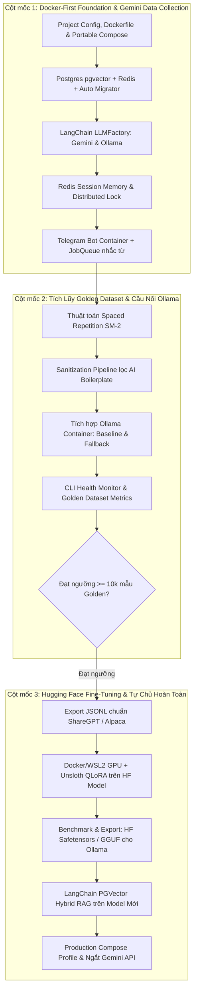

# Implementation Plan: Knowledge Distillation Telegram AI Bot (Enterprise & Docker-First)
*Architecture: Dockerized Python Bot + LangChain + Redis + PostgreSQL (pgvector)*
*Model Evolution: Gemini (Teacher) ➔ Open Source via Ollama (Local Bridge) ➔ Hugging Face Models (Fine-tuned Student)*

---

## 1. Phân Tích Bài Toán & Kiến Trúc Docker-First (Multi-Machine Team Portability)

### 1.1. Yêu cầu Cốt lõi về Triển khai Đa Máy (Team Collaboration)
Để dự án có thể chạy **đồng nhất 100%** trên mọi máy tính của các thành viên trong team (Windows, macOS, Linux — có GPU hoặc không có GPU) mà không gặp lỗi *"chạy được trên máy tôi nhưng lỗi trên máy bạn"*:
1. **Container hóa toàn bộ từ Ngày đầu (Docker-First):** Không chỉ Postgres/Redis/Ollama, bản thân **Python Telegram Bot** và **Alembic Migrator** cũng được đóng gói thành Docker container ngay từ Giai đoạn 1.
2. **Đường dẫn Volume Tương đối & Cấu hình qua `.env` (No Hardcoded `E:\`):**
   - Trong `docker-compose.yml`, tuyệt đối không hardcode đường dẫn ổ `E:\`.
   - Sử dụng biến môi trường `${DATA_DIR:-./data}` trong `.env`. Trên máy cá nhân của bạn, chỉ cần set `DATA_DIR=E:/AI-Telegram/data` trong file `.env` (file này không commit lên Git). Thành viên khác clone repo về sẽ mặc định lưu vào `./data` (hoặc tùy chỉnh ổ đĩa riêng của họ).
3. **Tách Profile Phần Cứng (GPU vs CPU / Mac Compatibility):**
   - Sử dụng **Docker Compose Profiles & Overrides** (`docker-compose.yml` + `docker-compose.gpu.yml`):
     - Máy không có NVIDIA GPU (hoặc Mac Apple Silicon, laptop mỏng nhẹ) chạy bình thường chế độ CPU / Gemini API mà không bị lỗi thiếu NVIDIA Container Toolkit.
     - Máy có GPU (như máy bạn dùng để chạy Ollama nhanh & fine-tune Hugging Face) chạy kèm `-f docker-compose.gpu.yml` để khai thác tối đa VRAM.
4. **Auto-Migration & Healthchecks:**
   - Container `migrator` tự động chạy `alembic upgrade head` ngay khi `postgres` đạt trạng thái `healthy`, sau đó `bot` mới khởi động. Teammate mới chỉ cần gõ duy nhất 1 lệnh `docker compose up -d` là có đủ database, bảng biểu và bot chạy ngay lập tức.

### 1.2. Lộ Trình Tiến Hóa Mô Hình 3 Tầng (3-Stage AI Pipeline)
Thông qua lớp trừu tượng **LangChain (`LLMFactory`)** và biến môi trường `AI_BACKEND`:
1. **Tầng 1 — `AI_BACKEND=gemini` (Teacher):** Dùng `ChatGoogleGenerativeAI` sinh dữ liệu vàng chuẩn xác, ép JSON qua Pydantic Structured Outputs.
2. **Tầng 2 — `AI_BACKEND=ollama` (Open Source qua Ollama):** Dùng `ChatOllama` chạy các model nhẹ (`qwen2.5:7b`, `llama3.1:8b`) làm cầu nối local, Local Fallback khi Gemini lỗi, và tạo Baseline benchmark.
3. **Tầng 3 — `AI_BACKEND=huggingface` (Chưng cất Tùy biến):** Dùng Hugging Face (`transformers`, `peft`, `trl`) + **Unsloth (QLoRA)** fine-tune base model từ Hugging Face Hub bằng Golden Dataset. Sau đó chạy qua `vLLM` / `ChatHuggingFace` hoặc đóng gói GGUF nạp ngược vào **Ollama (`Modelfile`)**.

### 1.3. Kiến Trúc Hệ Thống Dockerized

```
┌─────────────────────────── DOCKER COMPOSE NETWORK ───────────────────────────┐
│                                                                              │
│  [ Container: migrator ] ──(Run Alembic once)──┐                             │
│                                                ▼                             │
│  [ Container: bot ] <──────────────────> [ Container: postgres ]             │
│   (Python 3.11 + PTB + LangChain)         (pgvector/pgvector:pg16)           │
│         │              │                   Mount: ${DATA_DIR}/postgres       │
│         │              │                                                     │
│         ▼              ▼                                                     │
│  [ Container: redis ]  └──> [ Container: ollama ] (Profile: local-llm)       │
│   (redis:7-alpine)           (ollama/ollama)                                 │
│   Mount: ${DATA_DIR}/redis   Mount: ${DATA_DIR}/ollama                       │
│                                                                              │
│  [ Container: trainer / vllm ] (Phase 3 - Profile: gpu-train / prod-hf)      │
│   (WSL2 / NVIDIA CUDA + Unsloth + Hugging Face Models)                       │
└──────────────────────────────────────────────────────────────────────────────┘
```

---

## 2. Kế Hoạch Triển Khai Theo Cột Mốc Kỹ Thuật (Milestone-Driven)



---

## 3. Danh Mục Công Việc Chi Tiết (Tóm tắt từ `tasks/todo.md`)

### Phase 1: Docker-First Foundation & Gemini Data Collection
- **Task 1:** Cấu hình Dự án, Python 3.11+, `requirements.txt`, Pydantic Settings & `.env.example` (kèm biến `${DATA_DIR}`).
- **Task 2:** Đóng gói Docker Toàn Diện (Multi-stage `Dockerfile`, `.dockerignore`, `docker-compose.yml` với Profiles, Healthchecks & `docker-compose.gpu.yml`).
- **Task 3:** Thiết kế Database Models (SQLAlchemy 2.0 Async), `pgvector` & Auto-Migration Container (`migrator`).
- **Task 4:** Xây dựng Redis Service: Sliding Window Memory, Distributed Lock chống spam & LLM Query Cache.
- **Task 5:** Xây dựng `LLMFactory` & LangChain Teacher Engine (Gemini Structured Outputs + hỗ trợ switch Ollama).
- **Task 6:** Xây dựng Telegram Bot Core chạy trong Docker (Hot-reload dev mode, Handlers, `/model`, Chat Logger).
- **Task 7:** Xây dựng Module JobQueue Ôn tập Từ vựng với Inline Keyboard Trắc nghiệm.
*-> Checkpoint 1: Bất kỳ thành viên nào clone repo, chạy `docker compose up -d` là Bot, Postgres, Redis chạy ngay lập tức.*

### Phase 2: Data Maturation, Sanitization & Ollama Open-Source Bridge
- **Task 8:** Hiện thực hóa Thuật toán Spaced Repetition SuperMemo-2 (SM-2).
- **Task 9:** Xây dựng LangChain Sanitization Pipeline lọc khử "AI Persona" & Format Validator.
- **Task 10:** Tinh chỉnh System Prompt & Few-Shot Distillation Optimization.
- **Task 11:** Tích hợp Ollama Container (Qwen 2.5 / Llama 3.1) làm Local Fallback & Baseline Benchmark.
- **Task 12:** Xây dựng CLI Dataset Health Monitor & Golden Data Metric Tracker.
*-> Checkpoint 2: Dữ liệu sạch đạt ngưỡng $\ge 10.000$ mẫu, Ollama container giao tiếp mượt mà.*

### Phase 3: Hugging Face Fine-Tuning & Complete Self-Hosting
- **Task 13:** Xây dựng Script Export Dataset từ PostgreSQL ra file `dataset.jsonl` (ShareGPT/Alpaca).
- **Task 14:** Đóng gói Training Container (WSL2/Docker GPU + Unsloth + Hugging Face) để Fine-tune QLoRA 4-bit.
- **Task 15:** Benchmark Model & Export (HF Safetensors cho vLLM / GGUF nạp vào Ollama `Modelfile`).
- **Task 16:** Kích hoạt Local Hugging Face / Ollama Serving & PGVector Hybrid RAG.
- **Task 17:** Hoàn thiện Production Docker Compose & Tài liệu Team Onboarding (`README.md`), Ngắt Gemini API.
*-> Checkpoint 3: Hệ thống chạy hoàn toàn độc lập bằng container trên mọi máy hỗ trợ Docker.*

### Phase 3.5: Web Admin Dashboard (FastAPI + SQLAdmin)
*(Xem chi tiết kiến trúc và kế hoạch tại [`tasks/admin-dashboard/plan.md`](admin-dashboard/plan.md) và [`tasks/admin-dashboard/todo.md`](admin-dashboard/todo.md))*
- **Task 1:** Cấu hình Dependencies, Settings & Xác thực `AdminAuth` (Signed Session Cookie).
- **Task 2:** Khởi tạo FastAPI App & SQLAdmin Core Engine kết nối SQLAlchemy Async Engine.
- **Task 3:** ModelView Quản Trị Tri Thức: `VocabGroundTruthAdmin` & `GrammarGroundTruthAdmin` (Approve, Quarantine, Re-embed).
- **Task 4:** ModelView Giám Sát: `ChatLogAdmin` (ShareGPT turns) & `UserStudyScheduleAdmin` (Lịch học SM-2).
- **Task 5:** Custom Dashboard Stats & One-Click Dataset Exporter (`train.jsonl` / `eval.jsonl`).
- **Task 6:** Cập nhật Service `admin` trong `docker-compose.yml`, expose port 8000 & Toàn bộ Test Suite.
*-> Checkpoint 3.5: Quản trị viên đăng nhập web http://localhost:8000/admin kiểm duyệt từ vựng, ngữ pháp trực quan 1-click.*

### Phase 4: Document OCR, Scanned PDF & Multimodal Knowledge Ingestion
*(Xem chi tiết kiến trúc và kế hoạch tại [`tasks/phase4-document-ocr-ingestion/plan.md`](phase4-document-ocr-ingestion/plan.md) và [`tasks/phase4-document-ocr-ingestion/todo.md`](phase4-document-ocr-ingestion/todo.md))*
- **Task 1:** Unified Document Parser (`DocumentParserService`) — PyMuPDF (`fitz`), Digital & Scanned PDF detection.
- **Task 2:** Hybrid OCR Engine (`OCREngineService`) — Local RapidOCR ONNX + Cloud Gemini Multimodal Fallback.
- **Task 3:** Dual Knowledge Extractor (`DocumentKnowledgeExtractor`) — Trích xuất đồng thời Vocab & Grammar patterns.
- **Task 4:** Quality Gate, Content Sanitizer & Grammar Ingestion Service — Làm sạch rác OCR & Dual Ingestion với vector 768-dim.
- **Task 5:** Async Media Handlers & Live Progress Editing trên Telegram — Xử lý non-blocking & cập nhật tiến độ real-time.
- **Task 6:** Mở Rộng Admin Review CLI & Toàn Bộ Test Suite — Lọc theo nguồn OCR và kiểm thử End-to-End.
*-> Checkpoint 4: Người dùng gửi ảnh hoặc tài liệu PDF scan là bot tự động OCR, bóc tách từ vựng & ngữ pháp nạp DB ngay.*

---

## 4. Quản Trị Rủi Ro Đa Máy & Kỹ Thuật (Risks & Mitigations)

| Rủi ro | Hậu quả tiềm ẩn | Giải pháp triệt để |
| :--- | :--- | :--- |
| **Hardcode đường dẫn Windows (`E:\`)** | Đồng đội dùng macOS/Linux không chạy được Docker | Dùng `${DATA_DIR:-./data}` trong `docker-compose.yml`. Máy nào tự set đường dẫn ổ riêng trong `.env` cục bộ của máy đó. |
| **Máy đồng đội không có GPU NVIDIA** | `docker compose up` lỗi driver `nvidia` | Tách cấu hình GPU sang file riêng `docker-compose.gpu.yml`. Máy có GPU chạy kèm `-f docker-compose.gpu.yml`, máy thường chạy CPU/Gemini bình thường. |
| **Bot khởi động trước khi Postgres sẵn sàng** | Crash ngay lúc boot vì chưa có bảng | Dùng Docker `healthcheck` kết hợp service `migrator` chạy `alembic upgrade head` và `condition: service_completed_successfully`. |
| **Lệch phiên bản thư viện Python giữa các máy** | Lỗi import hoặc sai hành vi code | Toàn bộ code chạy trong cùng Docker image `python:3.11-slim` với version pin chặt trong `requirements.txt`. |
